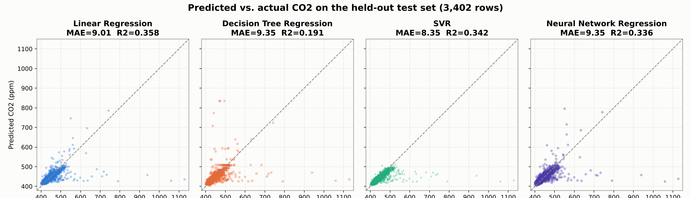
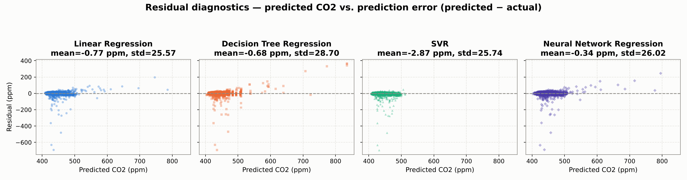
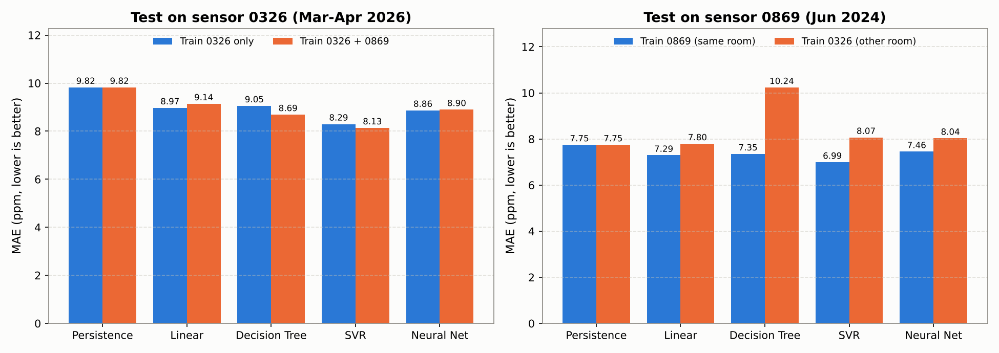
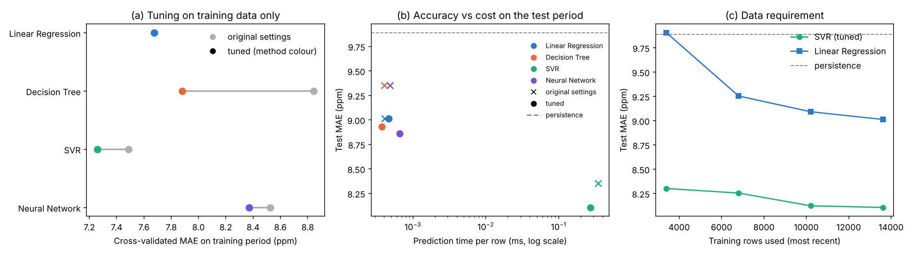
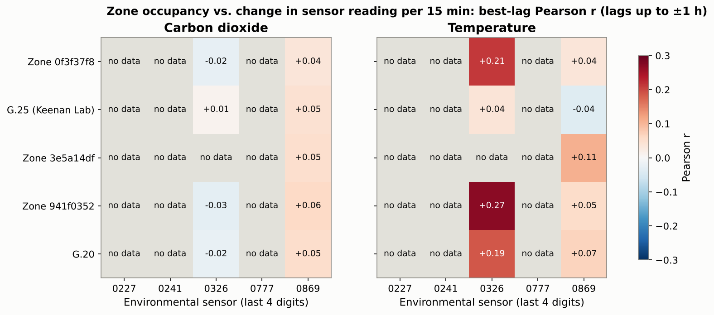
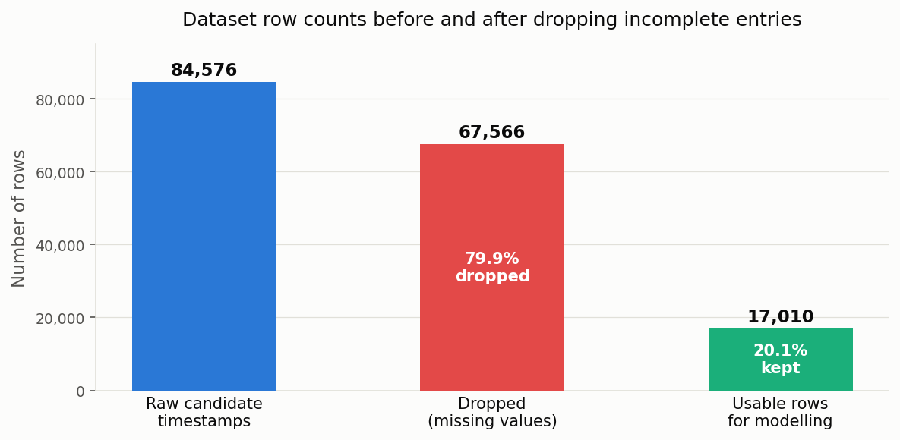

# Predicting Indoor CO₂ Concentration from Sensor History and Building Occupancy

**MMA3001 — Numerical Methods and Machine Learning, Project Report**
**Dataset:** MMA3001 Dataset 2 — Monash Smart Infrastructure Occupancy and Environmental Data
**Repository:** https://github.com/tgup0010-bot/MMA3001_FINAL

---

## 1. Engineering Problem

### 1.1 Engineering Context

Ventilation is a building-services task within mechanical engineering: fans and dampers in the heating, ventilation and air-conditioning (HVAC) system set the rate at which outdoor air dilutes the carbon dioxide (CO₂) that occupants exhale, at about 0.2–0.3 litres per minute per person. In a well-mixed room the concentration follows the single-zone mass balance used in ventilation engineering (Persily & de Jonge, 2017):

$$\frac{dC}{dt} = \frac{G \cdot N}{V} - \lambda \left(C - C_{\text{out}}\right)$$

where $C$ is indoor CO₂ (ppm), $G$ the per-person generation rate, $N$ the number of occupants, $V$ the room volume, $\lambda$ the ventilation rate (air changes per hour) and $C_{\text{out}}$ the outdoor concentration (about 420 ppm). CO₂ is therefore the standard control variable for demand-controlled ventilation (DCV), which sets outdoor airflow from measured CO₂ instead of a fixed design rate (Emmerich & Persily, 2001; ASHRAE, 2022a).

### 1.2 The Problem Being Addressed

DCV reacts to the current reading: by the time CO₂ crosses its setpoint the air is already stale, and the decay of CO₂ releases in this room gives a ventilation rate of about 3.9 air changes per hour, a time constant $1/\lambda$ of about 15 minutes (Section 4.2), so extra ventilation takes that long to act. A short-term forecast lets the system act before the setpoint is crossed. The dataset brief lists both "evaluating whether the available measurements support decisions about comfort or energy use" and auditing "potentially unreliable observations"; this project does both. It is a supervised regression problem with three research questions:

- **RQ1.** Can CO₂ 15 minutes ahead be forecast from recent sensor history and time of day, and which of the four Week 5 regression methods does it best?
- **RQ2.** Does building occupancy data improve that forecast?
- **RQ3.** Does adding a second sensor's data help, and does a model trained in one room transfer to another?

**Criterion for a useful forecast:** on a held-out later period, a model must beat the persistence forecast (next value equals current value), and its mean absolute error must be well below the 50 ppm margin used for an early-warning trigger (Section 2.5).

### 1.3 Why It Matters

HVAC accounts for roughly half of the energy used in buildings (Pérez-Lombard et al., 2008), so supplying more outdoor air than needed wastes fan and conditioning energy, while supplying too little degrades air quality. A common guideline, derived from earlier ASHRAE guidance, treats sustained CO₂ above about 1000 ppm as a sign of inadequate ventilation (ASHRAE, 2022b), and Satish et al. (2012) measured lower decision-making performance at 1000 ppm, although later studies have not all replicated the effect.

### 1.4 Intended Use

The forecaster is an advisory input to a building management system (BMS) or a facilities engineer. Every 15 minutes it takes the last hour of one room's CO₂ readings, the zone occupancy and the time, and returns the predicted CO₂ for the next 15 minutes; the BMS decides whether to raise outdoor airflow, and its own reactive setpoint stays in place as the safeguard, so the forecast is not safety-critical. Section 5.2 shows the models follow gradual changes but do not anticipate sudden rises, so the forecast suits early, gradual ventilation increases, not replacing a peak alarm. A model must be trained for each room (RQ3, Section 4.2).

### 1.5 Scope and Its Justification

| Scope decision | Justification |
|---------------------------|-------------------------------------------------|
| Main analysis on sensor `6012002000326`; `6012002000869` added for RQ3 | 0326 has the longest record of genuine readings; three of the five sensors contain none (Appendix C) |
| One forecast horizon, 15 minutes | About one room time constant (Section 4.2), long enough to act on; and the grid of the occupancy data |
| The four Week 5 regression methods; no ARIMA or recurrent networks | The unit's methods, compared on equal terms; the lag and rolling features already give them the autoregressive structure of the mass balance |
| No ventilation-rate or outdoor CO₂ inputs | Not in the dataset, so $\lambda$ and $C_{\text{out}}$ cannot be modelled directly; the mass balance motivates the features instead |
| One building; no closed-loop control simulation | The dataset covers one site, and simulating fan control needs an HVAC model that is not available; the project evaluates forecast quality only |

---

## 2. Inputs and Outputs

### 2.1 Top-Level Inputs

| Input file | Format | Content used | Sampling and period |
|------------------|------------------|--------------------------|------------------|
| Environmental sensor log (`5EnvSensor_…csv`, 337 MB) | CSV; a `jsondata` column holds a JSON array of variables, each with a Unix-epoch `time` and `value` | CO₂ (ppm), temperature (°C), relative humidity (%) for 5 sensors; `createdate` (server receive time) | Every 15 min when working; genuine readings Feb–Jun 2024 (0869) and Sep 2025–Apr 2026 (0326) |
| Occupancy event log (`5occupancySensor_…csv`, 1.5 GB) | CSV; one row per change of state | `floorspaceid` (zone); `occupancystatus`: CurrentlyOccupied, RecentlyOccupied or NotOccupied; `collecteddate` | Irregular (event-driven); 5 zones, Nov 2023–Apr 2026 |
| Sensor ID and Locations (`.xlsx`) | Lookup table | Room of each device | Sensor 0326 is not listed |
| Bureau of Meteorology daily observations, Moorabbin Airport, station 086077 | Monthly CSV | 9 am temperature and humidity | Daily, 222 days overlapping sensor 0326 |

The raw files exceed GitHub's 100 MB limit, so compact processed copies of the parts used are committed in `data/processed/`; every script uses the raw files when present and the copies otherwise, with identical results (README).

### 2.2 From Raw Data to Model Inputs

**Time.** All timestamps are converted to UTC and then to Australia/Melbourne local time, so the time-of-day features follow the building's clock across daylight-saving changes (the raw offsets switch between +10 and +11 hours).

**Binning.** The sensors report every 10 minutes; readings are averaged into 15-minute bins (one or two readings each), the grid of the occupancy data, and a bin with no reading is missing. Section 5.6 shows 10-minute bins give the same forecast skill.

**Occupancy.** A zone is occupied in a bin if its most recent status within the previous 2 hours is `CurrentlyOccupied`; `RecentlyOccupied`, the sensor's post-departure cooldown state, counts as not occupied. A zone with no event in the previous 2 hours is unknown. `building_occupancy` is the number of the five zones occupied: unknown zones count as not occupied, and the value is missing only when all five are unknown. The log's `headcount` column is not used, so the feature counts occupied zones, not people.

**Formulation.** The model learns $\hat{C}_{t+1} = f(C_t, C_{t-1}, \bar{C}_{t-1\text{h}}, O_t, \tau_t)$: next-bin CO₂ from the current and previous bins, the 1-hour mean, occupancy $O_t$ and time context $\tau_t$. Solving the mass balance over one step $\Delta t$ with occupancy and ventilation held constant gives $C_{t+1} = e^{-\lambda \Delta t} C_t + (1 - e^{-\lambda \Delta t}) C_{ss}$, where $C_{ss} = C_{\text{out}} + GN/(\lambda V)$: the next value is a scaled copy of the current one plus a term set by occupancy and ventilation, which is why these are the inputs.

| Feature | Units, type | Description |
|---------------------|------------|------------------------------------------|
| `co2_now` | ppm, continuous | CO₂ in the current bin; the strongest single predictor |
| `co2_lag1` | ppm, continuous | CO₂ 15 minutes ago; with `co2_now`, a backward difference giving the current trend |
| `co2_rolling_1h` | ppm, continuous | Mean of the last four bins including the current one; the medium-term trend |
| `building_occupancy` | count, integer 0–5 | Zones occupied (definition above); tested in RQ2 because $N$ drives generation |
| `hour_sin`, `hour_cos` | −1 to 1 | Hour of day as $(\sin(2\pi h/24), \cos(2\pi h/24))$, so 23:45 sits next to 00:00 |
| `dow_sin`, `dow_cos` | −1 to 1 | Day of week, encoded the same way |
| `is_weekend` | 0 or 1 | 1 on Saturday and Sunday |

### 2.3 Input Domains

Two domains are distinguished. The **valid domain** is what the model accepts at all, checked by `occupancy.input_validation`: CO₂ inputs 350–5000 ppm (indoor air cannot hold less CO₂ than the outdoor air ventilating it, allowing for sensor noise; 5000 ppm is the 8-hour occupational exposure limit, ACGIH and OSHA), occupancy a whole number 0–5, hour 0–23, day 0–6. The **trained domain** is the range of values in the training data: current CO₂ from 400 to 1387 ppm, but 99.5% of the 13,608 training rows lie between 400 and 550 ppm, so accuracy is established mainly in that band (Section 5.2). Valid inputs outside the training range are predicted but flagged as extrapolation.

### 2.4 Invalid, Missing and Unsupported Inputs

**Missing.** A row with any missing input or target is dropped, never filled. The dominant loss is a 636-day gap in genuine readings (11 December 2023 to 7 September 2025): imputing across it would invent hundreds of thousands of readings. Of 84,576 candidate 15-minute timestamps, 17,010 (20.1%) are complete and used. In effect only *unbroken intervals* are kept: runs of consecutive bins with no gap. A row needs four bins of history plus the next bin as target, so any interval of at least 75 minutes contributes, and an interval of $n$ bins yields $n - 4$ rows; sensor 0326 has 649 such intervals covering 4,978 hours. Section 5.3 counts 17,317 rows for the same sensor because those experiments do not use occupancy; the 307 extra rows are bins with no occupancy value.

**Invalid.** Three checks apply to the raw data. A reading received more than a day after its own timestamp is a re-sent stale packet, not a measurement; three sensors consist entirely of these (Appendix C). Failed reads (no value) and malformed JSON payloads are skipped when the log is loaded. For a forecast query, `validate_query` rejects values outside the valid domain with the reason, and the demonstration program refuses to predict from them.

**Unsupported.** Some inputs are valid but outside what the model was built for: CO₂ outside the trained range (flagged as extrapolation), a different room (a model trained on one room is worse than persistence on another, Section 5.3), and a different bin size or horizon (the model must be retrained). These cannot all be detected from one query, so they are stated here and in the README.

### 2.5 Outputs

| Output | Units | Meaning and intended use |
|------------------------------|-------|--------------------------------------|
| Forecast CO₂ for the next 15 minutes | ppm | The main output: an advisory input to the BMS. Typical error 8.1 ppm (MAE, selected SVR); sudden rises are not anticipated (Section 5.2) |
| Extrapolation warning | text | Flags a forecast made outside the trained domain |
| Model metrics (JSON in `reports/`) | ppm, R² | Compare methods and select the model (Section 5) |
| Test-set predictions (CSV in `reports/`) | ppm | Residual and diagnostic analysis (Section 5.2) |
| Cumulative CO₂ exposure (JSON in `reports/`) | ppm·h | Occupant exposure over a period; verifies the integration methods (Section 4.2) |
| Sensor audit results (JSON in `reports/`) | Pearson $r$ | Whether a sensor measures real conditions and which zone it serves (Sections 4.2, 6) |

The model only forecasts; thresholds and ventilation commands belong to the BMS. A practical rule might set an early-warning trigger at 750 ppm, 50 ppm below 800 ppm, a common stricter target than the 1000 ppm guideline. The 50 ppm margin is about six times the MAE and twice the RMSE of the selected model (Section 5). Inputs and outputs of each function (types, units and shapes) are documented in the docstrings and the generated HTML documentation.

---

## 3. Computational Approach

### 3.1 Methods and Why They Were Selected

The forecast is a supervised regression from the nine inputs of Section 2.2 to next-bin CO₂. Four Week 5 methods were compared because they span the range from fully interpretable to highly flexible: **Linear Regression** (the baseline any other method must beat), a **Decision Tree** (non-linear, readable rules), **Support Vector Regression** (smooth non-linear fit from a convex optimisation) and a **multilayer perceptron** (the most flexible). All four handle about 17,000 rows on a laptop in seconds, so the choice can rest on evidence rather than cost. A **persistence forecast** (next value equals current value) is the reference floor. The Week 6 **trapezoidal and Simpson's rules** compute cumulative CO₂ exposure and serve as an independent numerical check on the data pipeline.

### 3.2 How Each Method Works

**Linear Regression** fits $\hat{C}_{t+1} = \beta_0 + \sum_{i=1}^{9} \beta_i x_i$ by least squares. It cannot represent interactions, such as CO₂ rising faster on weekday mornings than on Sundays.

**Decision Tree Regression** splits the input space into rectangles by binary rules that minimise target variance; each leaf predicts the mean of its training rows, so its output is piecewise constant and cannot exceed the training range.

**SVR** finds the flattest function, in the space defined by the RBF kernel $K(\mathbf{x}_i, \mathbf{x}_j) = \exp(-\gamma \|\mathbf{x}_i - \mathbf{x}_j\|^2)$, that keeps residuals within a tube of half-width $\varepsilon$; $C$ penalises points outside it. Training is convex (one global optimum). Every training row on or outside the tube becomes a *support vector*, and each prediction sums a kernel term over all of them.

**The neural network** is a multilayer perceptron with ReLU hidden layers and a linear output, trained with Adam. Its loss is non-convex, so the result depends on the random starting weights.

**Numerical integration.** Cumulative exposure $E = \int C\,dt$ (ppm·h) is computed with the trapezoidal rule on the actual, irregular reading times (error $O(h^2)$) and with composite Simpson's 1/3 rule on a regular grid (error $O(h^4)$, needs an even number of intervals). A gap-aware variant skips panels wider than 2 hours, so the rule never interpolates across a sensor outage.

### 3.3 Assumptions

1. The room is well mixed, so one sensor represents it (the mass balance of Section 1.1).
2. The last hour of CO₂ plus time of day carries the information needed to forecast 15 minutes ahead (autoregression).
3. The process is stationary over the record: the training period behaves like the test period. This is what the chronological split tests.
4. A 15-minute mean of the 10-minute readings is representative of the bin.
5. Bins with missing data are absent, not zero; gaps over 2 hours are unknown.

### 3.4 Settings

All four models are scikit-learn `Pipeline` objects: a `StandardScaler` (fitted on training rows only, so no test information leaks into the scaling) followed by the regressor. Scaling matters most for SVR and the neural network, whose distances and gradients would otherwise be dominated by CO₂ in hundreds of ppm beside a 0/1 weekend flag.

| Setting | Original value | Selected value (Section 5.4) | Role |
|-----------------------|----------------|----------------|------------------------------------------|
| Tree `max_depth`, `min_samples_leaf` | 8, 1 | 4, 50 | Limit tree size; prevent memorising the training period |
| SVR $C$, $\varepsilon$, $\gamma$ | 10, 0.5 ppm, `scale` (≈0.11) | 100, 2 ppm, 0.03 | Penalty outside the tube, tube half-width, kernel width |
| MLP layers, $\alpha$ (L2 penalty) | 32→16, 10⁻⁴ | 64→32, 1.0 | Capacity and weight regularisation |
| MLP training | Adam, early stopping (10% validation, patience 10), at most 500 iterations, seed 42 | same | Convergence criterion and repeatability |
| Split | 80/20 chronological, cutoff 11 March 2026 | same | Training 13,608 rows, test 3,402 |

The original values were set by hand; the selected values come from the tuning in Section 5.4. The original $\varepsilon = 0.5$ ppm is below the sensor's 1 ppm resolution (consecutive overnight readings differ by a median of 6 ppm), so almost every training row (12,807 of 13,608) became a support vector.

### 3.5 Implementation

The code is a Python package, `src/occupancy`, with one module per task (loading, preprocessing, features, models, evaluation, integration, data quality, performance); experiment scripts in `scripts/` call it and write every reported number to `reports/*.json`. Each script runs from a fresh clone using the committed processed data (Section 2.1). Random seeds are fixed, 90 unit tests run on every push, and HTML documentation is generated from the docstrings.

### 3.6 Known Limitations of the Methods

Linear Regression is limited to additive effects. The tree's piecewise-constant output cannot extrapolate beyond the leaves it learned. SVR's prediction cost grows with the number of support vectors, and training scales between quadratically and cubically with rows. The neural network's result varies with the random seed (Section 5.6). Simpson's rule needs equally spaced, gap-free data; neither rule can recover readings that were never recorded.

---

## 4. Validation

### 4.1 Verification: Is the Code Correct?

Numerical code was first checked against problems with known answers, in 90 automated tests (`tests/`, report in `reports/test_report.html`). The trapezoidal rule integrates a constant exactly and matches the unit's worked example; Simpson's rule is exact for a quadratic; a Richardson check confirms the expected error reduction (4× for trapezoidal, 16× for Simpson's when $h$ halves); the metrics match hand-computed values, and predicting the mean gives $R^2 = 0$; the lagged-correlation search finds a planted CO₂ response and stays weak for unrelated series; the decay-rate fit recovers a known ventilation rate from a manufactured exponential; and the processed data reads back identical to the raw files.

### 4.2 Validation Design

**What was validated:** the forecast accuracy of each model (RQ1–RQ3), the reliability of the sensor itself, the physical plausibility of its readings, and the integration results.

| Evidence (brief's category) | Method | Why appropriate |
|--------------------|-----------------------|--------------------------------------|
| Withheld test data | Last 20% of rows in time order, used once at the end | Matches deployment: the model only ever sees the past. A random split would place test rows beside near-identical training rows 15 minutes away and measure interpolation, not forecasting |
| Cross-validation | 5-fold time-series cross-validation inside the training period (each fold trains on earlier rows, scores on the next block) | Selects settings and the final model without touching the test data |
| Trusted benchmark | Persistence forecast; bootstrap intervals on paired error differences (one-day blocks, as errors are correlated in time) | A model that cannot beat "no change" is useless; the intervals show whether differences are larger than chance |
| Independent data | Sensor temperature and humidity vs Bureau of Meteorology (Moorabbin Airport) over 222 days: $r$ = +0.84 and +0.65 | A faulty sensor (stuck value, frozen clock) would give $r$ near zero |
| Physical constraint | Decay of 87 sharp CO₂ releases fitted to the mass balance: ventilation rate 3.9 h⁻¹ (interquartile range 2.9–5.1), time constant about 15 minutes | Exponential decay at a consistent rate across 87 events, as the mass balance predicts; a sensor artefact would not do this |
| Established method | Trapezoidal vs Simpson's on a 41-hour gap-free window: agree within 0.1% at 15, 30 and 60-minute spacing (Appendix B) | Two independent rules agreeing shows the data handling, not just one formula, is consistent |

**Metrics and acceptance criteria.** MAE (typical error, ppm) is the selection metric; RMSE (sensitive to large misses) and $R^2$ (variance explained relative to predicting the mean) are reported alongside. Acceptance, from Section 1.2: beat persistence with a bootstrap interval excluding zero, and MAE well below the 50 ppm alarm margin.

**Did validation influence model selection?** Yes, but only the cross-validation scores did. The original comparison (Section 5.1) chose SVR by its test-set MAE, which lets the test data influence the choice; this was corrected in Section 5.4, where tuning and selection use the training period only and the test period is used once.

**What validation cannot establish.** It covers one sensor in one building over seven months, so it says nothing about other rooms (Section 5.3 shows models do not transfer), other seasons or a changed HVAC schedule. It measures forecast error, not whether ventilation control would actually improve, which would need a closed-loop trial. Above 550 ppm there are only 25 test rows, so accuracy at high CO₂ is poorly determined.

---

## 5. Comparison and Optimisation

### 5.1 Baseline Comparison (Original Settings)

| Method | MAE (ppm) | RMSE (ppm) | R² | Training MAE (ppm) |
|---|---|---|---|---|
| Persistence (benchmark) | 9.89 | 29.34 | 0.155 | n/a |
| Linear Regression | 9.01 | **25.58** | **0.358** | 7.67 |
| Decision Tree | 9.35 | 28.71 | 0.191 | 6.71 |
| SVR | **8.35** | 25.89 | 0.342 | 6.80 |
| Neural Network | 9.35 | 26.02 | 0.336 | 7.88 |

Test period: 3,402 rows. All four models beat persistence. SVR has the lowest MAE, and the bootstrap interval on its advantage over Linear Regression (0.66 ppm, 95% interval 0.39 to 0.94) excludes zero; Linear Regression has the lowest RMSE and highest $R^2$. The Decision Tree overfits: it has the lowest training error but the gap to its test error is the largest (6.71 vs 9.35 ppm).

**RQ2, occupancy.** Removing building occupancy changes $R^2$ by at most 0.002 for Linear Regression, SVR and the neural network, and improves the Decision Tree (0.191 to 0.331), which was spending splits on it. Section 6 explains why: nothing links this sensor to any monitored zone. Its daily cycle agrees: it peaks at 07:00 and has identical weekday and weekend working-hours means (436 ppm), following the ventilation schedule, whereas room G.38 (sensor 0869) peaks at 13:00 and is 55 ppm higher on weekdays.

### 5.2 Where the Models Fail

{width=6.3in}

{width=6.3in}

The averages hide the important failure. On the 63 test rows where CO₂ rose by more than 30 ppm within 15 minutes, **no model predicted any of the rise**: the median share of the rise predicted is zero, and their error there (about 110 ppm) equals the persistence error. The residual plot shows the signature: large negative errors at ordinary predicted values (a spike arrived unforeseen) and positive errors at high predicted values (the model followed the spike one step late). The original SVR never predicted above 512 ppm and is biased low by 2.9 ppm. The models therefore beat persistence by smoothing normal fluctuations, not by anticipating releases, which come from events the inputs cannot see. The time series is in Appendix A.

### 5.3 More Data and Other Rooms (RQ3)

Cutting each sensor's record into unbroken intervals adds sensor 0869 (room G.38): 7,781 rows from February to June 2024; the other three sensors only ever re-send one stale packet (Appendix C). Using original settings and no occupancy: pooling both sensors (+56% training rows) changes SVR's MAE from 8.30 to 8.14 ppm, and no model's change is significant (all bootstrap intervals span zero). Trained on its own room, every model beats persistence on sensor 0869 (SVR MAE 6.99 ppm, $R^2$ 0.78); trained on the other room, every model is worse than persistence (7.75 ppm). A forecaster must be trained for each room.

{width=5.2in}

### 5.4 Optimisation: Tuning and the Selected Design

Each method's settings were tuned by grid search (Section 3.4 lists the ranges) with 5-fold time-series cross-validation on the training period only, and the final model was chosen by cross-validated MAE (`scripts/optimisation_and_performance.py`).

| Method | CV MAE, original (ppm) | CV MAE, tuned (ppm) | Test MAE, tuned (ppm) | Test R², tuned |
|---|---|---|---|---|
| Linear Regression | 7.67 | 7.67 (no settings) | 9.01 | 0.358 |
| Decision Tree | 8.84 | 7.88 | 8.93 | 0.371 |
| **SVR (selected)** | 7.49 | **7.26** | **8.11** | 0.372 |
| Neural Network | 8.53 | 8.37 | 8.86 | 0.376 |

{width=6.5in}

SVR has the lowest cross-validated error, and in every one of the five folds. On the test period the selected SVR ($C$ = 100, $\varepsilon$ = 2 ppm, $\gamma$ = 0.03) improves on the original SVR by 0.24 ppm (95% interval 0.10 to 0.43) and beats every alternative: persistence by 1.78 ppm (1.32 to 2.30), Linear Regression by 0.91 ppm (0.68 to 1.16), the tuned tree by 0.82 ppm and the tuned neural network by 0.76 ppm (both intervals exclude zero). Tuning fixed the tree's overfitting (test $R^2$ 0.191 to 0.371). The selected design meets the acceptance criteria: it beats persistence, and its 8.1 ppm MAE is a sixth of the 50 ppm margin.

### 5.5 Performance: Time, Memory and Operations

| Model (selected settings) | Fit (s) | Predict 3,402 rows (ms) | FLOPs per prediction | Model size (kB) |
|---|---|---|---|---|
| Linear Regression | 0.007 | 1.6 | 36 | 1 |
| Decision Tree | 0.017 | 1.3 | 22 (comparisons) | 4 |
| SVR | 5.4 | 924 | 5.1 × 10⁵ | 879 |
| Neural Network | 4.1 | 2.2 | 5.5 × 10³ | 78 |

Times are medians of repeated runs; peak memory while fitting was 2–4 MB for every model. Operation counts explain the times: an RBF-SVR prediction costs about $n_{sv}(3d + 22)$ FLOPs, and with $d$ = 9 inputs and 10,437 support vectors that is about 500,000 per row, 14,000 times the linear model's 36. Each support vector's 80 bytes must be read for about 49 operations, an arithmetic intensity of 0.6 FLOP/byte, so SVR prediction is limited by memory traffic (measured 1.9 GFLOP/s, against 8.4 GFLOP/s for the neural network's dense matrix products). Tuning reduced the support vectors from 12,807 to 10,437 (prediction about 20% faster) because the wider tube ignores errors under 2 ppm. Even so, 0.3 ms per forecast is negligible for a decision taken every 15 minutes. A `cProfile` run of the whole workflow from the raw files showed that 54% of the time went on parsing timestamps and reading the 1.9 GB of CSV, and only 7% on fitting SVR; the committed processed data removes that cost, cutting the main experiment from 109 s to 26 s.

### 5.6 Sensitivity and Robustness

- **Input resolution.** One-bin-ahead skill over persistence is 18% for 10-minute and 15-minute bins and 15% for 30-minute bins (SVR): 15 minutes loses nothing and matches the occupancy grid.
- **Data requirement.** With only the most recent quarter of the training rows, SVR's test MAE is 8.30 ppm against 8.11 with all of them; Linear Regression needs the full set (9.91 to 9.01). More data of the same kind is not the bottleneck, consistent with the pooling result.
- **Repeatability.** SVR gives identical results on every run. The tuned neural network's test MAE ranges from 8.68 to 9.26 ppm over five random seeds, a spread larger than most differences between methods.
- **Robustness over time.** The cross-validation folds cover different months; fold MAE varies from 5.9 to 8.4 ppm for SVR, and SVR is best in every fold.
- **Integration gap threshold.** Exposure changes by 1.2% for thresholds from 0.5 to 24 hours (2.29 to 2.31 million ppm·h), but bridging the 636-day outage inflates it fourfold (9.54 million): only the outage matters.
- **Outliers.** A Hampel filter (5 robust standard deviations from the hourly median) flags 293 of 29,038 genuine readings (1.0%). They are rises followed by smooth decays, genuine releases rather than glitches, and replacing them in the training data worsens the test MAE (8.11 to 8.22 ppm). They were kept.

**Final design.** The tuned SVR is selected: it is the most accurate on every validation measure, and its cost is irrelevant at a 15-minute decision interval. Linear Regression remains the fallback where interpretability or a tiny model matters: 0.9 ppm less accurate, with 36 operations per forecast and coefficients an engineer can read.

---

## 6. Limitations and Lessons Learned

**Limitations.**

- **No model anticipates sudden rises** (Section 5.2). The forecast suits gradual, early ventilation changes, not a replacement for the BMS's reactive alarm.
- **The main sensor has no documented room.** Sensor 0326 is not in the location spreadsheet. A data-driven search correlated each zone's occupancy with the 15-minute *change* in each sensor's readings at lags up to ±1 hour (levels would correlate for every room through the shared daily cycle). For CO₂, $|r| \le 0.03$ for every zone with overlapping data (Appendix C). Temperature reaches $r$ = 0.27 but rises 45–60 minutes *before* occupancy: a building-wide HVAC warm-up, not shared occupants. This explains RQ2.
- **Three of five sensors contain no genuine readings**; they re-send one stale packet about every 11 minutes (e.g. 666 ppm in all 21,363 rows of sensor 0227). This was found by comparing each reading's timestamp with the server receive time and is not documented in the dataset.
- **80% of candidate rows are dropped** because of the 636-day outage, and only 25 test rows exceed 550 ppm.
- **Accuracy is moderate** ($R^2$ about 0.37): two thirds of the variance comes from factors not in the data (doors, windows, HVAC switching, the room's own occupants).
- **One room, one building, seven months**; models must be retrained per room.

**Lessons learned.**

1. **Audit the raw data before modelling.** The three "frozen" sensors, the outage and the missing room location were all found by inspecting timestamps, not by the models.
2. **Averages can hide the failure that matters.** A better MAE came from smoothing ordinary noise; the spikes an early warning exists for were not predicted at all.
3. **Never let the test set choose the model.** The first comparison did; time-series cross-validation inside the training period fixed it, and the selected model was confirmed only once on the test data.
4. **Check claims against the data.** Two stated justifications (the 15-minute sensor cadence and $\varepsilon$ matched to sensor noise) were false when measured, and an assumed 30-minute time constant was really about 15 minutes.
5. **Numerical methods fail at the data, not the formula.** The trapezoidal rule was correct, but applied across an outage it inflated exposure fourfold.
6. **Report negative results.** Occupancy did not help, pooling did not help and models did not transfer; each answer narrows what a real deployment would need: per-room training and occupancy sensing in the forecast room.

---

## 7. AI Use and Reflection

**Tools.** Claude Code (Anthropic), used in a cloud session with access to the repository, and the Claude chat interface (claude.ai), used to read the brief, plan and review.

**What AI was used for, and approximate contribution.** Claude wrote most of the Python code (an estimated 80–90% of lines), ran the analyses, generated the figures and API documentation, and drafted most of the report prose, including the revision of every section against the brief and rubric. My contribution was the engineering direction, the decisions listed below, checking results and editing. I used AI for implementation and drafting because it is fast at boilerplate code, plotting and restructuring text, which left my time for the engineering judgements.

**Decisions that remained mine.** Choosing CO₂ forecasting over occupancy classification; choosing the sensor and requiring the Bureau of Meteorology check before trusting it; testing occupancy as a feature rather than assuming its value; taking the teaching team's advice to use every sensor's valid intervals; deciding to report the non-significant pooling result and the negative transfer result as they are; and accepting the final model and its stated limitations.

**How AI output was checked.** Every number in this report was traced to an output file in `reports/` produced by a script that reruns from a fresh clone; I read the code paths behind key results; the numerical code is covered by unit tests with known answers (Section 4.1); and claims were rechecked against the raw data.

**Errors and unhelpful output from AI.** The first integration code bridged the 636-day outage and inflated exposure fourfold; I required an explanation when the result looked wrong, which exposed it. An AI clean-up deleted a module and its tests, later restored. AI-written text stated two justifications that measurement showed false (the 15-minute cadence and the $\varepsilon$ setting), described the residual plot backwards, and misreported the integration discrepancy as ninefold. The original model comparison selected SVR on test data, a methodological flaw the AI did not flag until the work was audited. AI also added itself as a co-author on a commit against my instruction, and once said the processed data was committed when it was not. Each was found by checking output against the data, the code or the repository.

**Effect on understanding and workflow: benefits and drawbacks.** The benefit was scale: AI made it possible to run far more analysis than I could have coded alone (cross-validation, bootstrap intervals, profiling, the decay fit). The drawback was confident errors that looked plausible, so checking took real time; the errors above taught me to treat every AI statement as a claim to verify rather than a result.

---

## References

- MMA3001 Project Brief, Monash University, 2026.
- MMA3001 Project Datasets document, Monash University, 2026. Dataset 2: Monash Smart Infrastructure Occupancy and Environmental Data.
- MMA3001 Notes, Week 5.1–5.6: Regression methods and evaluation. Monash University, 2026.
- MMA3001 Notes, Week 6: Numerical Integration (trapezoidal, Simpson's, Richardson extrapolation). Monash University, 2026.
- ACGIH. Carbon dioxide: TLV-TWA 5000 ppm. American Conference of Governmental Industrial Hygienists; also OSHA Permissible Exposure Limit, 29 CFR 1910.1000 Table Z-1 (5000 ppm, 8-hour TWA).
- ASHRAE (2022a). Standard 62.1: Ventilation and Acceptable Indoor Air Quality. American Society of Heating, Refrigerating and Air-Conditioning Engineers.
- ASHRAE (2022b). Position Document on Indoor Carbon Dioxide. American Society of Heating, Refrigerating and Air-Conditioning Engineers.
- Bureau of Meteorology. Daily Weather Observations, Moorabbin Airport (station 086077). http://www.bom.gov.au/climate/dwo/
- Emmerich, S. J. & Persily, A. K. (2001). State-of-the-Art Review of CO₂ Demand Controlled Ventilation Technology and Application. NISTIR 6729, National Institute of Standards and Technology.
- Hampel, F. R. (1974). The influence curve and its role in robust estimation. *Journal of the American Statistical Association*, 69(346), 383–393.
- Künsch, H. R. (1989). The jackknife and the bootstrap for general stationary observations. *Annals of Statistics*, 17(3), 1217–1241.
- Pedregosa, F. et al. (2011). Scikit-learn: Machine learning in Python. *Journal of Machine Learning Research*, 12, 2825–2830. Documentation for LinearRegression, DecisionTreeRegressor, SVR, MLPRegressor, GridSearchCV and TimeSeriesSplit: https://scikit-learn.org/
- Persily, A. & de Jonge, L. (2017). Carbon dioxide generation rates for building occupants. *Indoor Air*, 27(5), 868–879.
- Pérez-Lombard, L., Ortiz, J. & Pout, C. (2008). A review on buildings energy consumption information. *Energy and Buildings*, 40(3), 394–398.
- Satish, U. et al. (2012). Is CO₂ an indoor pollutant? Direct effects of low-to-moderate CO₂ concentrations on human decision-making performance. *Environmental Health Perspectives*, 120(12), 1671–1677.

## Appendix A: Test-Period Time Series

{width=5.5in}

{width=6.3in}

## Appendix B: Numerical Integration Cross-Check

Cumulative CO₂ exposure on a 41-hour gap-free window (1–3 October 2025), sensor 0326 (`scripts/co2_integration_analysis.py`).

| Bin size | Points | Trapezoidal (ppm·h) | Simpson's (ppm·h) | Relative difference |
|---|---|---|---|---|
| 15 min | 163 | 17,817.3 | 17,829.9 | 0.071% |
| 30 min | 83 | 18,019.8 | 18,019.9 | 0.001% |
| 60 min | 41 | 17,583.8 | 17,571.8 | 0.068% |

The two rules agree within 0.1% at each spacing. The differences *between* spacings come from averaging the readings into different bins, not from integration error, so this is a consistency check; the order of accuracy is verified separately against an exact integral (Section 4.1).

## Appendix C: Sensor Audit

| Sensor (last 4 digits) | Raw rows | Distinct readings | Stale re-sent rows | Usable intervals | Hours | Usable rows |
|---|---|---|---|---|---|---|
| 0326 | 58,909 | 29,039 | 29,342 | 649 | 4,978 | 17,317 |
| 0869 | 29,341 | 13,800 | 15,297 | 458 | 2,403 | 7,781 |
| 0241 | 58,908 | 2 | 58,908 | 0 | 0 | 0 |
| 0227 | 21,363 | 1 | 21,363 | 0 | 0 | 0 |
| 0777 | 10,926 | 1 | 10,926 | 0 | 0 | 0 |

{width=6.3in}

{width=5.2in}

## Appendix D: Data Pipeline

{width=3.6in}
