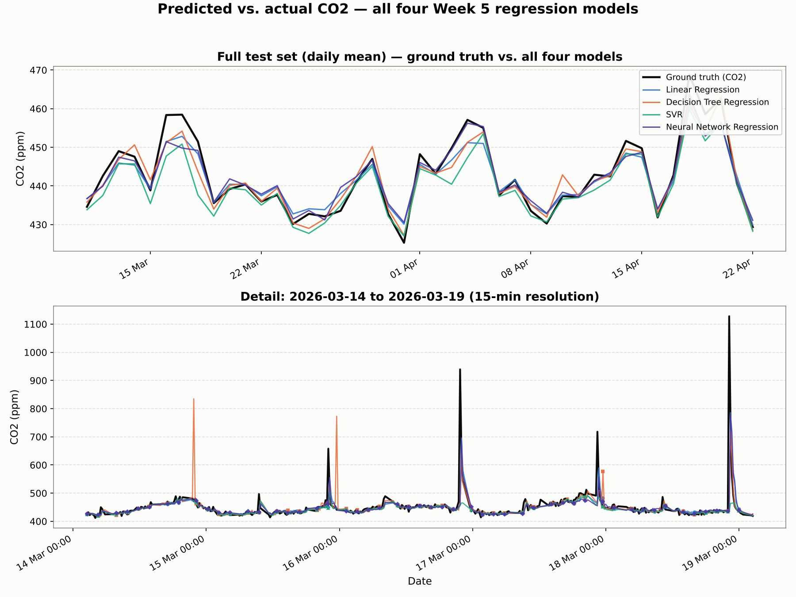
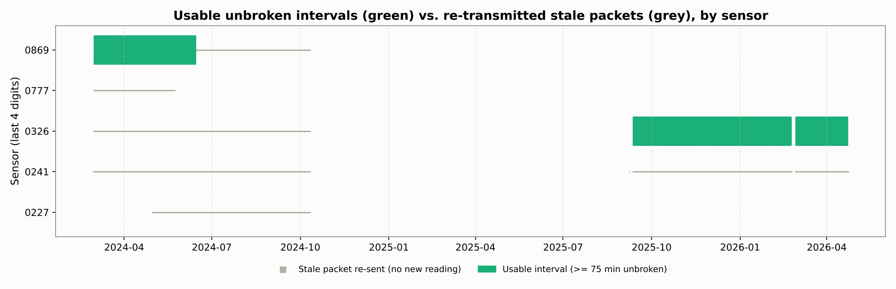
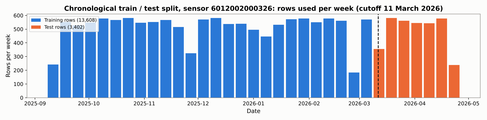

# Predicting Indoor CO₂ Concentration from Sensor History and Building Occupancy

**MMA3001 — Numerical Methods and Machine Learning, Project Report**
**Dataset:** MMA3001 Dataset 2 — Monash Smart Infrastructure Occupancy and Environmental Data
**Repository:** https://github.com/tgup0010-bot/MMA3001_FINAL

---

## 1. Engineering Problem

### 1.1 Engineering Context

Ventilation is a building-services task within mechanical engineering: fans and dampers in the heating, ventilation and air-conditioning (HVAC) system set the rate at which outdoor air dilutes the carbon dioxide (CO₂) that occupants exhale, at about 0.2–0.3 litres per minute per person. In a well-mixed room the concentration follows the single-zone mass balance used in ventilation engineering (Persily & de Jonge, 2017):

$$\frac{dC}{dt} = \frac{G \cdot N}{V} - \lambda \left(C - C_{\text{out}}\right)$$

where $C$ is indoor CO₂ (ppm), $G$ the per-person generation rate, $N$ the number of occupants, $V$ the room volume, $\lambda$ the ventilation rate (air changes per hour) and $C_{\text{out}}$ the outdoor concentration (about 420 ppm). CO₂ is therefore the standard control variable for demand-controlled ventilation (DCV), which sets outdoor airflow from measured CO₂ instead of a fixed design rate (Emmerich & Persily, 2001; ASHRAE, 2022a).

### 1.2 The Problem Being Addressed

DCV reacts to the current reading: by the time CO₂ crosses its setpoint the air is already stale, and with a typical $\lambda$ of about 2 air changes per hour the room's time constant $1/\lambda$ is about 30 minutes, so extra ventilation takes tens of minutes to act. A short-term forecast lets the system act before the setpoint is crossed. The dataset brief lists both "evaluating whether the available measurements support decisions about comfort or energy use" and auditing "potentially unreliable observations"; this project does both. It is a supervised regression problem with three research questions:

- **RQ1.** Can CO₂ 15 minutes ahead be forecast from recent sensor history and time of day, and which of the four Week 5 regression methods does it best?
- **RQ2.** Does building occupancy data improve that forecast?
- **RQ3.** Does adding a second sensor's data help, and does a model trained in one room transfer to another?

**Criterion for a useful forecast:** on a held-out later period, a model must beat the persistence forecast (next value equals current value), and its mean absolute error must be well below the 50 ppm margin used for an early-warning trigger (Section 2.5).

### 1.3 Why It Matters

HVAC accounts for roughly half of the energy used in buildings (Pérez-Lombard et al., 2008), so supplying more outdoor air than needed wastes fan and conditioning energy, while supplying too little degrades air quality. A common guideline, derived from earlier ASHRAE guidance, treats sustained CO₂ above about 1000 ppm as a sign of inadequate ventilation (ASHRAE, 2022b), and Satish et al. (2012) measured lower decision-making performance at 1000 ppm, although later studies have not all replicated the effect.

### 1.4 Intended Use

The forecaster is an advisory input to a building management system (BMS) or a facilities engineer. Every 15 minutes it takes the last hour of one room's CO₂ readings, the zone occupancy and the time, and returns the predicted CO₂ for the next 15 minutes; the BMS decides whether to raise outdoor airflow, and its own reactive setpoint stays in place as the safeguard, so the forecast is not safety-critical. Section 4 shows the models track the trend closely but under-predict sharp peaks, so the forecast is suited to early, gradual ventilation increases, not to replacing a peak alarm. A model must be trained for each room (RQ3, Section 4.2).

### 1.5 Scope and Its Justification

| Scope decision | Justification |
|---------------------------|-------------------------------------------------|
| Main analysis on sensor `6012002000326`; `6012002000869` added for RQ3 | 0326 has the longest record of genuine readings; three of the five sensors contain none (Section 4.2) |
| One forecast horizon, 15 minutes | Matches the 15-minute reporting interval and is about half the room time constant: long enough to act on, short enough to predict from history |
| The four Week 5 regression methods; no ARIMA or recurrent networks | The unit's methods, compared on equal terms; the lag and rolling features already give them the autoregressive structure of the mass balance |
| No ventilation-rate or outdoor CO₂ inputs | Not in the dataset, so $\lambda$ and $C_{\text{out}}$ cannot be modelled directly; the mass balance motivates the features instead |
| One building; no closed-loop control simulation | The dataset covers one site, and simulating fan control needs an HVAC model that is not available; the project evaluates forecast quality only |

---

## 2. Inputs and Outputs

### 2.1 Top-Level Inputs

| Input file | Format | Content used | Sampling and period |
|------------------|------------------|--------------------------|------------------|
| Environmental sensor log (`5EnvSensor_…csv`, 337 MB) | CSV; a `jsondata` column holds a JSON array of variables, each with a Unix-epoch `time` and `value` | CO₂ (ppm), temperature (°C), relative humidity (%) for 5 sensors; `createdate` (server receive time) | Every 15 min when working; genuine readings Feb–Jun 2024 (0869) and Sep 2025–Apr 2026 (0326) |
| Occupancy event log (`5occupancySensor_…csv`, 1.5 GB) | CSV; one row per change of state | `floorspaceid` (zone); `occupancystatus`: CurrentlyOccupied, RecentlyOccupied or NotOccupied; `collecteddate` | Irregular (event-driven); 5 zones, Nov 2023–Apr 2026 |
| Sensor ID and Locations (`.xlsx`) | Lookup table | Room of each device | Sensor 0326 is not listed |
| Bureau of Meteorology daily observations, Moorabbin Airport, station 086077 | Monthly CSV | 9 am temperature and humidity | Daily, 222 days overlapping sensor 0326 |

The raw files exceed GitHub's 100 MB limit, so compact processed copies of the parts used are committed in `data/processed/`; every script uses the raw files when present and the copies otherwise, with identical results (README).

### 2.2 From Raw Data to Model Inputs

**Time.** All timestamps are converted to UTC and then to Australia/Melbourne local time, so the time-of-day features follow the building's clock across daylight-saving changes (the raw offsets switch between +10 and +11 hours).

**Binning.** Each sensor's readings are averaged into 15-minute bins; a bin with no reading is missing.

**Occupancy.** A zone is occupied in a bin if its most recent status within the previous 2 hours is `CurrentlyOccupied`; `RecentlyOccupied`, the sensor's post-departure cooldown state, counts as not occupied. A zone with no event in the previous 2 hours is unknown. `building_occupancy` is the number of the five zones occupied: unknown zones count as not occupied, and the value is missing only when all five are unknown. The log's `headcount` column is not used, so the feature counts occupied zones, not people.

**Formulation.** The model learns $\hat{C}_{t+1} = f(C_t, C_{t-1}, \bar{C}_{t-1\text{h}}, O_t, \tau_t)$: next-bin CO₂ from the current and previous bins, the 1-hour mean, occupancy $O_t$ and time context $\tau_t$. Solving the mass balance over one step $\Delta t$ with occupancy and ventilation held constant gives $C_{t+1} = e^{-\lambda \Delta t} C_t + (1 - e^{-\lambda \Delta t}) C_{ss}$, where $C_{ss} = C_{\text{out}} + GN/(\lambda V)$: the next value is a scaled copy of the current one plus a term set by occupancy and ventilation, which is why these are the inputs.

| Feature | Units, type | Description |
|---------------------|------------|------------------------------------------|
| `co2_now` | ppm, continuous | CO₂ in the current bin; the strongest single predictor |
| `co2_lag1` | ppm, continuous | CO₂ 15 minutes ago; with `co2_now`, a backward difference giving the current trend |
| `co2_rolling_1h` | ppm, continuous | Mean of the last four bins including the current one; the medium-term trend |
| `building_occupancy` | count, integer 0–5 | Zones occupied (definition above); tested in RQ2 because $N$ drives generation |
| `hour_sin`, `hour_cos` | −1 to 1 | Hour of day as $(\sin(2\pi h/24), \cos(2\pi h/24))$, so 23:45 sits next to 00:00 |
| `dow_sin`, `dow_cos` | −1 to 1 | Day of week, encoded the same way |
| `is_weekend` | 0 or 1 | 1 on Saturday and Sunday |

### 2.3 Input Domains

Two domains are distinguished. The **valid domain** is what the model accepts at all, checked by `occupancy.input_validation`: CO₂ inputs 350–5000 ppm (indoor air cannot hold less CO₂ than the outdoor air ventilating it, allowing for sensor noise; 5000 ppm is the 8-hour occupational exposure limit, ACGIH and OSHA), occupancy a whole number 0–5, hour 0–23, day 0–6. The **trained domain** is the range of values in the training data: current CO₂ from 400 to 1387 ppm, but 99.5% of the 13,608 training rows lie between 400 and 550 ppm, so accuracy is established mainly in that band (Section 4.1). Valid inputs outside the training range are predicted but flagged as extrapolation.

### 2.4 Invalid, Missing and Unsupported Inputs

**Missing.** A row with any missing input or target is dropped, never filled. The dominant loss is a 636-day gap in genuine readings (11 December 2023 to 7 September 2025): imputing across it would invent hundreds of thousands of readings. Of 84,576 candidate 15-minute timestamps, 17,010 (20.1%) are complete and used. In effect only *unbroken intervals* are kept: runs of consecutive bins with no gap. A row needs four bins of history plus the next bin as target, so any interval of at least 75 minutes contributes, and an interval of $n$ bins yields $n - 4$ rows; sensor 0326 has 649 such intervals covering 4,978 hours. Section 4.2 counts 17,317 rows for the same sensor because those experiments do not use occupancy; the 307 extra rows are bins with no occupancy value.

**Invalid.** Three checks apply to the raw data. A reading received more than a day after its own timestamp is a re-sent stale packet, not a measurement; three sensors consist entirely of these (Section 4.2). Failed reads (no value) and malformed JSON payloads are skipped when the log is loaded. For a forecast query, `validate_query` rejects values outside the valid domain with the reason, and the demonstration program refuses to predict from them.

**Unsupported.** Some inputs are valid but outside what the model was built for: CO₂ outside the trained range (flagged as extrapolation), a different room (a model trained on one room is worse than persistence on another, Section 4.2), and a different bin size or horizon (the model must be retrained). These cannot all be detected from one query, so they are stated here and in the README.

### 2.5 Outputs

| Output | Units | Meaning and intended use |
|------------------------------|-------|--------------------------------------|
| Forecast CO₂ for the next 15 minutes | ppm | The main output: an advisory input to the BMS. Typical error 8.35 ppm (MAE, SVR), larger above about 600 ppm, where the models under-predict (Section 4.1) |
| Extrapolation warning | text | Flags a forecast made outside the trained domain |
| Model metrics (JSON in `reports/`) | ppm, R² | Compare methods and select the model (Section 4) |
| Test-set predictions (CSV in `reports/`) | ppm | Residual and diagnostic analysis (Section 4.1) |
| Cumulative CO₂ exposure (JSON in `reports/`) | ppm·h | Occupant exposure over a period; verifies the integration methods (Section 5.4) |
| Sensor audit results (JSON in `reports/`) | Pearson $r$ | Whether a sensor measures real conditions and which zone it serves (Sections 5.3, 6) |

The model only forecasts; thresholds and ventilation commands belong to the BMS. A practical rule might set an early-warning trigger at 750 ppm, 50 ppm below 800 ppm, a common stricter target than the 1000 ppm guideline. The 50 ppm margin is about six times the MAE and twice the RMSE (Section 4). Inputs and outputs of each function (types, units and shapes) are documented in the docstrings and the generated HTML documentation.

---

## 3. Computational Solution

### 3.1 Implementation

All four models are scikit-learn `Pipeline` objects with a `StandardScaler` step (zero mean, unit variance per feature) before the estimator. Scaling is essential for SVR and the neural network: the RBF kernel uses Euclidean distances, which unscaled features (CO₂ in ppm beside a 0/1 weekend flag) would distort. Using the same preprocessing for all four keeps the comparison fair.

### 3.2 How Each Method Works

**Linear Regression** fits a hyperplane through the training data by minimising the sum of squared residuals:

$$\hat{C}_{t+1} = \beta_0 + \sum_{i=1}^{9} \beta_i x_i$$

It assumes each feature contributes linearly and additively, so it cannot capture interactions (e.g. high CO₂ on a weekday morning rising faster than on a Sunday). It is the interpretable baseline the other methods must beat.

**Decision Tree Regression** splits the feature space into rectangular regions with binary splits that minimise target variance; each leaf predicts the mean CO₂ of its training points. It captures non-linearity and interactions but tends to overfit, so maximum depth was limited to 8.

**Support Vector Regression (SVR)** fits a smooth function that keeps most residuals inside an ε-wide tube and penalises points outside it, working in a high-dimensional space defined implicitly by the RBF kernel

$$K(\mathbf{x}_i, \mathbf{x}_j) = \exp\!\left(-\gamma \|\mathbf{x}_i - \mathbf{x}_j\|^2\right)$$

Training is a convex optimisation with no local minima, so it is more stable than the neural network. $C = 10$ sets the penalty for leaving the tube; $\varepsilon = 0.5$ ppm is the tube half-width.

**Neural Network Regression** is a multilayer perceptron with two ReLU hidden layers (32 then 16 units) and a linear output, trained with Adam and early stopping (patience of 10 epochs). It is the most expressive method, but the least interpretable and the most data-hungry.

### 3.3 Parameters

| Parameter | Value | Rationale |
|---------|-------|------------------------|
| Bin size | 15 minutes | Matches sensor reporting cadence |
| Prediction horizon | 15 minutes ahead | Minimum lead time for meaningful ventilation pre-emption |
| Train/test split | 80 % / 20 %, chronological | Reflects deployment: model only sees past data |
| Training cutoff | 11 March 2026 | 80th-percentile row in the 17,010-row dataset |
| Decision Tree max depth | 8 | Limits leaf count; prevents memorisation of training period |
| SVR kernel | RBF | Handles smooth non-linearity without specifying a basis |
| SVR $C$ | 10 | Moderate regularisation; less restrictive than scikit-learn default |
| SVR $\varepsilon$ | 0.5 | Tube width matched to sensor noise level |
| NN hidden layers | 32 → 16 units | Sufficient capacity for 9 inputs; small enough to avoid overfitting 13,608 rows |
| NN early stopping patience | 10 epochs | Halts training when validation loss stops improving |

---

## 4. Alternative Solutions and Comparison

The four methods were evaluated on the held-out test set (3,402 rows, the final 20% in time order).

| Method | MAE (ppm) | RMSE (ppm) | R² | Fit time (s) | Predict time (ms) | Interpretability |
|---|---|---|---|---|---|---|
| Linear Regression | 9.012 | 25.579 | 0.358 | 0.005 | 1.7 | High |
| Decision Tree | 9.353 | 28.708 | 0.191 | 0.023 | 2.5 | Medium |
| **SVR** | **8.350** | **25.894** | **0.342** | 4.26 | 2854 | Low |
| Neural Network | 9.350 | 26.015 | 0.336 | 2.36 | 2.3 | Very low |

**SVR** has the lowest MAE (8.35 ppm). Linear Regression has the highest R² (0.358), is close in MAE, and is the better choice where interpretability or speed matters. The Decision Tree is weakest (R² 0.191), likely overfitting, as its large RMSE relative to MAE suggests. SVR's prediction time (about 2.85 s per batch) is no constraint for a 15-minute task.

**Effect of building occupancy on prediction accuracy:**

| Method | R² with occupancy | R² without occupancy | Change |
|---|---|---|---|
| Linear Regression | 0.358 | 0.358 | 0.000 |
| Decision Tree | 0.191 | 0.331 | −0.140 |
| SVR | 0.342 | 0.344 | −0.002 |
| Neural Network | 0.336 | 0.335 | +0.001 |

Occupancy gives no measurable improvement for any model, and the Decision Tree gets worse (R² 0.331 to 0.191) by wasting splits on it. Occupancy matters in principle (the mass balance), but nothing links this sensor to any of the five monitored zones (Section 6), so the building-wide count says nothing about this room.

The daily pattern agrees (`scripts/weekday_weekend_comparison.py`). In room G.38 (sensor `6012002000869`), weekday CO₂ peaks at 13:00 and averages 505 ppm in working hours (9 am–5 pm) against 450 ppm at weekends — an occupied room. Sensor `6012002000326` peaks at 07:00, is lowest at 15:00, and has identical weekday and weekend working-hours means (436 ppm): it follows the ventilation schedule, not occupants, so neither occupancy nor the weekend flag helps.

### 4.1 Diagnostic plots

The comparison table above is aggregate; the plots below show what it looks like row by row.

{width=4.3in}

All four track the everyday CO2 trend closely; they diverge at the sharp spikes in the detail panel (14-19 March), where every model lags or flattens the peak — the Decision Tree even overshoots into a spike the sensor never reached (15 March), a symptom of its piecewise-constant leaves extrapolating from a small high-CO2 training leaf.

{width=6.3in}

{width=6.3in}

Predicted-vs-actual makes the R² numbers concrete: all four point clouds hug y=x below 550 ppm, then fall well short of it as actual CO2 rises past 600 ppm. The residual plots show the same effect directionally: residuals sit near zero typically but turn increasingly negative as predicted CO2 rises, rather than scattering symmetrically — a model under-responding to its most extreme inputs, consistent with the training data being dominated by the 400-550 ppm range (Section 2.4).

### 4.2 Using every usable interval from all sensors

Rather than accepting or rejecting whole sensors, the unbroken-interval rule (Section 2.4) was applied to all five: any interval of at least 75 minutes is usable. Comparing each reading's timestamp with the server receive time (`createdate`) showed that a sensor which stops measuring keeps re-sending its last packet about every 11 minutes.

| Sensor (last 4 digits) | Raw rows | Distinct readings | Stale re-sent rows | Usable intervals | Hours | Usable rows |
|---|---|---|---|---|---|---|
| 0326 | 58,909 | 29,039 | 29,342 | 649 | 4,978 | 17,317 |
| 0869 | 29,341 | 13,800 | 15,297 | 458 | 2,403 | 7,781 |
| 0241 | 58,908 | 2 | 58,908 | 0 | 0 | 0 |
| 0227 | 21,363 | 1 | 21,363 | 0 | 0 | 0 |
| 0777 | 10,926 | 1 | 10,926 | 0 | 0 | 0 |

{width=5.2in}

Three sensors never produce more than two distinct readings, so no interval can be formed. Sensor `6012002000869` (room G.38, the only documented sensor) has genuine readings from 29 February to 13 June 2024, giving 7,781 more rows. Both experiments below exclude occupancy (it adds nothing, Section 4) and include a naive *persistence* forecast (next CO₂ = current CO₂) as the floor a useful model must beat.

**Experiment A: pooled training.** Train on sensor `6012002000326`'s training period plus all of `6012002000869` (2024, before the cutoff); test on the unchanged `6012002000326` test period.

| Method | MAE, 0326 only (ppm) | MAE, pooled (ppm) | R², 0326 only | R², pooled |
|---|---|---|---|---|
| Persistence | 9.823 | 9.823 | 0.161 | 0.161 |
| Linear Regression | 8.969 | 9.138 | 0.362 | 0.324 |
| Decision Tree | 9.053 | 8.687 | 0.258 | 0.315 |
| **SVR** | 8.295 | **8.135** | 0.349 | 0.373 |
| Neural Network | 8.865 | 8.897 | 0.375 | 0.381 |

Pooling adds 56% more training data (13,853 to 21,634 rows). SVR improves slightly (MAE 8.30 to 8.14 ppm) and the data-hungry Decision Tree most, but no change is statistically significant: 95% moving-block bootstrap intervals (one-day blocks) on the paired MAE difference all span zero, e.g. SVR +0.16 ppm [−0.07, +0.44]. All models beat persistence (9.82 ppm).

**Experiment B: cross-sensor transfer.** Train on `6012002000326` only and test on the final 20% of `6012002000869`, against a model trained on `6012002000869`'s own earlier data (figure, right).

{width=5.2in}

Trained on its own room, every model beats persistence (7.75 ppm) and SVR is best (MAE 6.99 ppm, R² 0.78). Trained on the other room, every model is *worse than persistence* (Decision Tree 10.24 ppm). The models learn room-specific behaviour — the level each room settles to and how fast it returns — and the rooms are driven differently: G.38 by occupants, sensor `6012002000326` by the ventilation schedule (Section 4). A forecaster must be trained per room.

## 5. Validation

### 5.1 Train/Test Split

The first 80% of rows (13,608, up to 11 March 2026) were used for training and the final 20% (3,402) for testing. A random split was deliberately avoided: CO₂ is strongly autocorrelated, so randomly placed test points would sit beside near-identical training points, and the score would measure interpolation rather than forecasting an unseen future. The chronological split matches deployment.

{width=5.5in}

### 5.2 Evaluation Metrics

**Mean Absolute Error (MAE):**

$$\text{MAE} = \frac{1}{n} \sum_{i=1}^{n} |\hat{y}_i - y_i|$$

The average error in ppm, robust to occasional outliers: an MAE of 8.35 ppm means predictions are on average 8.35 ppm from the true reading.

**Root Mean Square Error (RMSE):**

$$\text{RMSE} = \sqrt{\frac{1}{n} \sum_{i=1}^{n} (\hat{y}_i - y_i)^2}$$

The square penalises large errors, so an RMSE well above the MAE signals occasional large errors despite a small typical error.

**Coefficient of Determination (R²):**

$$R^2 = 1 - \frac{\sum_{i=1}^{n}(\hat{y}_i - y_i)^2}{\sum_{i=1}^{n}(y_i - \bar{y})^2}$$

The fraction of target variance explained: 1 is perfect, 0 is no better than predicting the mean. The models reach 0.19–0.36, about a third of the variance; the rest comes from factors not in the dataset (HVAC switching, doors, windows, equipment, and this room's occupants).

### 5.3 Sensor Validation Against External Records

The sensor's temperature and humidity were compared with Bureau of Meteorology observations at Moorabbin Airport (station 086077, the nearest official station to Monash Clayton) over 222 overlapping days.

| Variable | Pearson r (sensor vs BOM) |
|---|---|
| Temperature | +0.84 |
| Relative Humidity | +0.65 |

A faulty sensor (stuck reading, frozen clock or noise) would show correlations near zero, so these strong values indicate that sensor `6012002000326` measures real conditions.

### 5.4 Numerical Integration Convergence

The Week 6 trapezoidal and Simpson's rules were implemented from the lecture formulae (not library functions) to compute cumulative CO₂ exposure in ppm·h, and compared at three bin sizes on a 41-hour gap-free window (1–3 October 2025).

| Bin size | Points | Trapezoidal (ppm·h) | Simpson (ppm·h) | Relative difference |
|---|---|---|---|---|
| 15 min | 163 | 17,817.3 | 17,829.9 | 0.071 % |
| 30 min | 83 | 18,019.8 | 18,019.9 | 0.001 % |
| 60 min | 41 | 17,583.8 | 17,571.8 | 0.068 % |

The methods agree within 0.1% at every bin size, confirming the implementation. The variation between bin sizes reflects the readings sampled at each density, not numerical error.

---

## 6. Limitations and Known Failure Modes

**The sensor has no documented room location.** Sensor `6012002000326` is not in the Sensor ID and Locations spreadsheet, so its room and matching occupancy zone are unknown. A data-driven sensor-matching analysis was run instead (`occupancy.sensor_matching`, `scripts/sensor_matching_analysis.py`): for every zone–sensor pair on 15-minute bins, Pearson's $r$ was computed between the zone's occupancy and the *change* in the reading (its first difference), searching lags up to ±4 bins (±1 hour) and keeping the strongest. Changes are used rather than levels because every room follows the same working-day cycle, which would make all pairs look related. CO₂, temperature and humidity were tested (`reports/sensor_matching_results.json`).

{width=5.2in}

For CO₂, sensor `6012002000326` shows no relationship with any zone ($|r| \le 0.03$ for the four zones with overlapping data), and no sensor exceeds $|r| = 0.06$. Temperature reaches $r = 0.27$, but at lags of −3 to −4 bins: it rises 45–60 minutes *before* occupancy, pointing to a building-wide HVAC warm-up rather than shared occupants. This cannot prove the sensor is outside every zone, but finds no evidence linking it to any.

**Three of the five sensors contain no genuine readings.** Sensors `6012002000227`, `6012002000777` and `6012002000241` first appeared to have frozen clocks. The server receive time (`createdate`) shows that their rows arrive regularly but are all one stale packet re-sent with the same value (e.g. 666 ppm in all 21,363 rows of `6012002000227`), so no interval can be formed. The usable sensors show the same fault outside their genuine periods. Sensor `6012002000869` has only 3.5 months of genuine data, too little for the main analysis, and is used in Section 4.2. None of this is documented in the dataset description; it was found by inspecting raw timestamps and values.

**Most candidate rows are discarded.** The 636-day gap reduces 84,576 candidate rows to 17,010 (20.1%); imputing across it would fabricate data. Adding a second sensor's intervals (+56% training data) does not measurably improve accuracy (Section 4.2).

**Models do not transfer between rooms.** Trained on one sensor, every model is worse than persistence on another (Section 4.2); each room needs its own training data.

**Predictive accuracy is moderate.** R² of 0.34–0.36 leaves two thirds of the variability to unobserved factors (HVAC switching, windows, doors, the room's own occupants). The model suits use as a trend indicator for early ventilation, not as a precise point forecast.

**Integration must be gap-aware.** Applied naively across the full record, treating the 636-day outage as one step, the trapezoidal rule gives 9.54 million ppm·h; skipping panels whose endpoints are more than 2 hours apart gives 2.31 million ppm·h. The factor of four comes entirely from bridging the outage.

---

## 7. AI Use and Critical Reflection

Claude (Claude Code) was used throughout this project for data exploration, Python implementation, analysis, and drafting this report. The following is a straightforward account of how it was used and what I contributed.

**What Claude assisted with:** Setting up the package structure, writing the scikit-learn pipeline code, running the four-model comparison, performing the integration analysis, implementing the sensor-matching analysis (a lagged correlation search, following Keenan Granland's EdStem suggestion to look for a sensor–zone link in the data itself), and producing drafts of this report.

**What I directed and decided:** I chose CO₂ prediction over occupancy classification because it was a better fit for the regression focus of MMA3001 Week 5 and for the structure of the available data. I selected which sensor to use and required external validation before accepting it as reliable. I chose to include occupancy as a feature and test it empirically rather than exclude or include it by assumption. When the cumulative exposure from numerical integration came out about four times too large, I required an explanation before accepting it — this investigation identified the gap-bridging error in the original implementation (Section 6).

**Follow-up after teaching-team feedback:** After discussing the project with the teaching team, I was advised to use the valid time intervals from the other sensors instead of discarding them entirely. I brought this feedback to Claude and asked for it to be applied. Claude proposed and implemented the interval audit, the pooled and cross-sensor experiments and the bootstrap significance check (Section 4.2), and found, by comparing the `createdate` field with each reading's own timestamp, that the "frozen" sensors were re-sending a single stale packet. I approved the experiments and the decision to report the non-significant pooling result and the negative cross-sensor result as they are.

**Repository maintenance:** Claude also restored a module and tests that an earlier cleanup had deleted, regenerated the API documentation and test report, and corrected this report's description of the zone-matching analysis so that it matches the code in `occupancy.sensor_matching`.

**What I verified:** All numerical results in this report were checked against the actual output files (`reports/co2_prediction_results.json`, `reports/multi_sensor_results.json`, `reports/sensor_matching_results.json`, `reports/weekday_weekend_results.json`) before being recorded here. The integration estimates and convergence results come from scripts that can be rerun to reproduce the same outputs.

**Honest acknowledgement:** In extended AI-assisted work, the precise boundary between ideas that originated with me and ideas that emerged from interaction with Claude cannot always be drawn clearly. The engineering framing, scope decisions, sensor selection rationale, and interpretation of results are mine. The implementation and much of the written prose were produced collaboratively.

---

## References

- MMA3001 Project Brief, Monash University, 2026.
- MMA3001 Project Datasets document, Monash University, 2026. Dataset 2: Monash Smart Infrastructure Occupancy and Environmental Data.
- MMA3001 Notes, Week 5.1–5.6: Regression methods and evaluation. Monash University, 2026.
- MMA3001 Notes, Week 6: Numerical Integration. Monash University, 2026.
- ACGIH. Carbon dioxide: TLV-TWA 5000 ppm. American Conference of Governmental Industrial Hygienists; also OSHA Permissible Exposure Limit, 29 CFR 1910.1000 Table Z-1 (5000 ppm, 8-hour TWA).
- ASHRAE (2022a). Standard 62.1: Ventilation and Acceptable Indoor Air Quality. American Society of Heating, Refrigerating and Air-Conditioning Engineers.
- ASHRAE (2022b). Position Document on Indoor Carbon Dioxide. American Society of Heating, Refrigerating and Air-Conditioning Engineers.
- Emmerich, S. J. & Persily, A. K. (2001). State-of-the-Art Review of CO₂ Demand Controlled Ventilation Technology and Application. NISTIR 6729, National Institute of Standards and Technology.
- Pérez-Lombard, L., Ortiz, J. & Pout, C. (2008). A review on buildings energy consumption information. *Energy and Buildings*, 40(3), 394–398.
- Persily, A. & de Jonge, L. (2017). Carbon dioxide generation rates for building occupants. *Indoor Air*, 27(5), 868–879.
- Satish, U. et al. (2012). Is CO₂ an indoor pollutant? Direct effects of low-to-moderate CO₂ concentrations on human decision-making performance. *Environmental Health Perspectives*, 120(12), 1671–1677.
- Bureau of Meteorology. Daily Weather Observations, Moorabbin Airport (station 086077). http://www.bom.gov.au/climate/dwo/
- scikit-learn documentation: LinearRegression, DecisionTreeRegressor, SVR, MLPRegressor, StandardScaler, Pipeline. https://scikit-learn.org/

## Appendix A: Data Pipeline

{width=3.6in}
